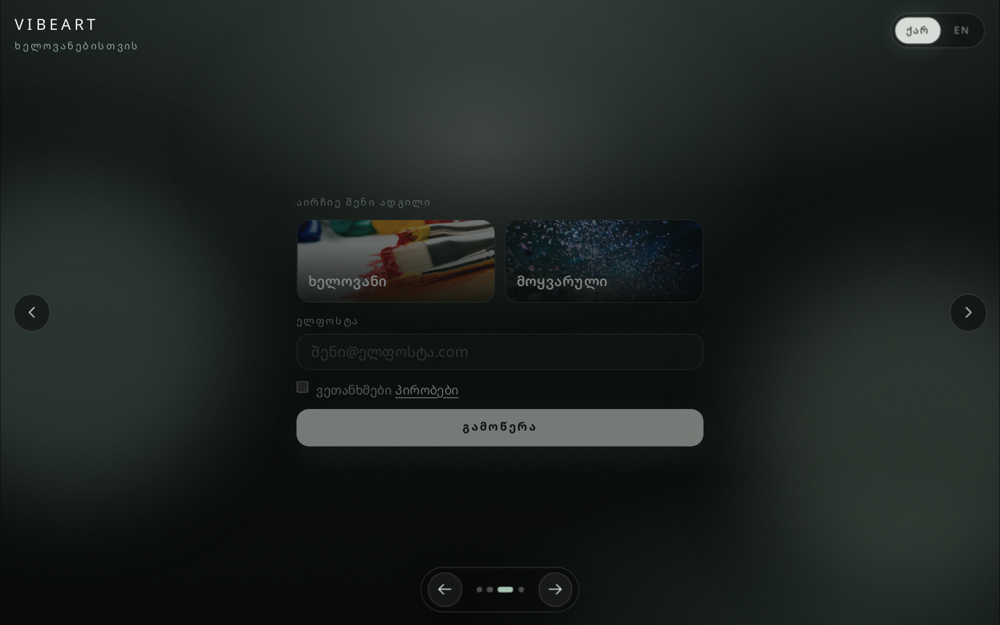

<div align="center">

# VIBEART

**Take a front row seat.**

A bilingual waitlist for a live platform built only for artists —  
ქართული + English, one immersive experience.

<br/>

[](https://sli.dev)
[](https://vuejs.org)
[](#)

</div>

<br/>

<p align="center">
  
</p>

---

## Preview

| Stage | Live | Subscribe |
| :---: | :---: | :---: |
|  |  |  |

<p align="center">
  
</p>

---

## What it is

A **4-screen** product waitlist for market research:

1. **Cover** — stage atmosphere + title + tagline  
2. **Live** — artist stream mock (Twitch-like for creatives)  
3. **Subscribe** — email + Artist / Art lover  
4. **Terms** — short bilingual copy  

Language toggle stays in the corner. Side + bottom arrows on every screen.

---

## Quick start

```bash
npm install
npm run dev
```

Open [http://127.0.0.1:43123](http://127.0.0.1:43123)

| Command | Purpose |
| --- | --- |
| `npm run dev` | Local Slidev server |
| `npm run build` | Static export to `dist/` |
| `npm run export` | Export slides |

---

## Subscribe data

Emails are saved locally to `data/subscribers.json`.

```bash
ADMIN_SECRET=change-me \
curl -H "x-admin-secret: change-me" \
  http://127.0.0.1:43123/api/subscribers
```

> For a public deploy (Vercel / Netlify), wire a durable store next  
> (Google Sheet, Airtable, or a database) — local JSON will not persist there.

---

## Structure

```text
├── slides.md              # 4 visual screens
├── components/            # Vue UI (form, live screen, nav…)
├── composables/           # KA / EN locale
├── layouts/immersive.vue  # Full-bleed stage layout
├── public/images/         # Real stage / studio photos
├── server/subscribers.ts  # Email storage
└── docs/screenshots/      # README previews
```

---

<div align="center">

**Keep creating. Keep believing.**

`VIBEART` · for artists

</div>
