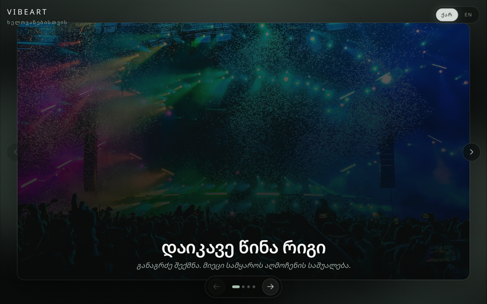
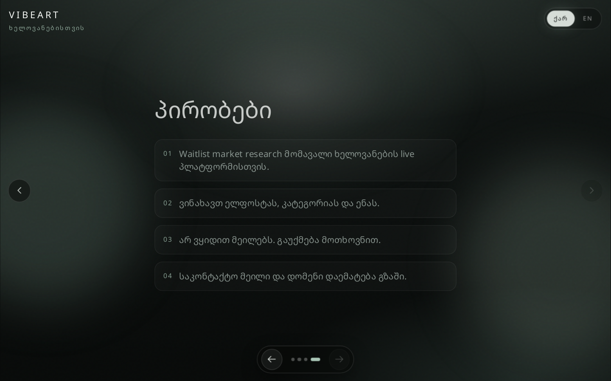

<p align="center">
  
</p>

<h1 align="center">VIBEART</h1>

<p align="center">
  <strong>Take a front row seat.</strong><br/>
  Bilingual waitlist for a live platform built only for artists.<br/>
  <em>ქართული · English</em>
</p>

<p align="center">
  Keep creating. Keep believing.<br/>
  Let the world discover what you have to offer.
</p>

---

## Screens

<p align="center">
  
</p>

<p align="center">
  
</p>

<p align="center">
  
</p>

<p align="center">
  
</p>

---

## What’s inside

| Screen | Feeling |
| --- | --- |
| **1 · Cover** | Stage light + title + tagline |
| **2 · Live** | Artist stream mock |
| **3 · Subscribe** | Email + Artist / Art lover |
| **4 · Terms** | Short KA / EN copy |

Side arrows + bottom dots on every page. Language toggle stays top-right.

---

## Run locally

```bash
npm install
npm run dev
```

Open **http://127.0.0.1:43123**

---

## See who subscribed

Emails are stored in `data/subscribers.json`.

```bash
ADMIN_SECRET=change-me \
curl -H "x-admin-secret: change-me" \
  http://127.0.0.1:43123/api/subscribers
```

For a public site, connect a Google Sheet / Airtable / database next —  
local files do not persist on Vercel.

---

<p align="center">
  <sub>VIBEART · for artists</sub>
</p>
